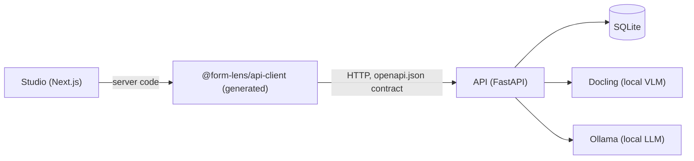

# Project Constitution

> Source of truth for this project's rules; edit via `/sdd:constitution`. Every WHAT NOT TO DO
> entry carries a reason (incident, trade-off, upstream constraint) — otherwise it becomes folklore.

**Last reviewed:** 2026-11-14
**Owners:** Szum-Tech Team

---

## 1. Tech stack

### api (`apps/api`)

- **Runtime:** Python ≥ 3.15, uv (own `uv.lock`; the uv version is pinned in `apps/api/Dockerfile` and in `UV_VERSION` of every workflow that sets it)
- **Framework:** FastAPI, uvicorn, Pydantic / pydantic-settings
- **Database:** SQLite (WAL, `BEGIN IMMEDIATE` for writes) through SQLAlchemy 2.1; schema by Alembic inside the package (`src/formlens/migrations`)
- **Tests:** pytest (random order via pytest-randomly, `pytest-timeout`, warnings are errors), coverage with `fail_under = 95` (branch), Hypothesis, Schemathesis
- **Lint / format:** Ruff (format + lint), mypy strict, import-linter (contracts in `pyproject.toml`)
- **Other notable libs:** Docling (document parsing, local VLM: `mlx` or `transformers`), Ollama through `httpx2` (field extraction), structlog, jsonschema; contract tooling Spectral, oasdiff, pip-audit

### @form-lens/studio (`apps/studio`)

- **Runtime:** Node ≥ 26, npm workspaces (one `package-lock.json` at the root)
- **Framework:** Next.js 16 (App Router, Turbopack, React Compiler), React 19, TypeScript 7 (strict)
- **Database:** none; the Studio reads data through `@form-lens/api-client`
- **Tests:** Vitest (`unit` project in Node, `storybook` project in a Playwright browser), Playwright E2E, Storybook with a11y addon
- **Lint / format:** Biome, Knip
- **Other notable libs:** `@szum-tech/design-system`, Tailwind CSS 4, Zod 4, T3 Env, LogLayer + Pino, next-themes

### @form-lens/api-client (`packages/api-client`)

- **Runtime:** Node ≥ 26, TypeScript 7
- **Framework:** Orval generates the client from `apps/api/openapi.json` into `src/generated`
- **Tests:** Vitest (`src/**/*.test.ts`, Node) for the hand-written code (`src/fetcher.ts`, the entry point); `generate:check` fails when the generated code drifts from the spec
- **Lint / format:** `tsc --noEmit`

### Repository

- Nx monorepo (`api`, `@form-lens/studio`, `@form-lens/api-client`); `apps/api` is a standalone uv project.
- CI gate: `Check ✅` (over all other jobs) and `Audit 🔒`; releases by release-please per app from Conventional Commits.

**Why this stack:** the owner's choice and preference; no trade-offs or rejected alternatives are recorded. The apps started
from the owner's own templates (`docs/templates.md`).

**Links:**
- Architecture decision records: none; architecture notes in `apps/api/docs/explanation/architecture.md`
- Onboarding docs: root `README.md`, `apps/api/CLAUDE.md`, `apps/studio/CLAUDE.md`, `docs/releases.md`, `docs/templates.md`

---

## 2. Run/build commands

<!-- Single source for SDD commands and agents. One row per project in specs/capabilities.md
     (`root` for a single app). Each command runs from the spec repo's root, so include the `cd`
     (`cd apps/api && uv run pytest`). `test` runs the full suite, `coverage` the suite with a
     coverage report (/sdd:review prefers it), `dev` starts the app locally (extra review checks use it).
     Empty cell = no command. -->

| Project | Path | test | coverage | typecheck | lint | dev |
|---------|------|------|----------|-----------|------|-----|
| api | `apps/api` | `cd apps/api && uv run pytest` | `cd apps/api && uv run coverage run -m pytest && uv run coverage report` | `cd apps/api && uv run mypy` | `cd apps/api && uv run ruff format --check . && uv run ruff check . && uv run lint-imports` | `cd apps/api && make run` |
| @form-lens/studio | `apps/studio` | `npm run test:unit -w @form-lens/studio` | `npm run test:unit:coverage -w @form-lens/studio` | `npm run type-check -w @form-lens/studio` | `npm run biome:check -w @form-lens/studio && npm run knip -w @form-lens/studio` | `npm run dev -w @form-lens/studio` |
| @form-lens/api-client | `packages/api-client` | `npm run test:unit -w @form-lens/api-client` | `npm run test:unit:coverage -w @form-lens/api-client` | `npm run type-check -w @form-lens/api-client` | `npm run generate:check -w @form-lens/api-client` | |

- `api`: `make check` (or `npx nx run api:check` from the root) runs the full CI gate, including `make openapi-check`.
  `uv run pytest -m slow` (`make test-models`) needs downloaded models and a running Ollama; the default run deselects it.
- After an API contract change: `cd apps/api && make openapi`, then `npm run generate -w @form-lens/api-client`.
  `packages/api-client/src/generated` is generated; never edit it.
- `@form-lens/studio`: `npm test -w @form-lens/studio` also runs the Storybook tests in a Playwright browser; CI runs
  `test:unit`.

---

## 3. Architecture

FormLens extracts structured data from forms. The Studio (Next.js) is the web app; it calls the API (FastAPI) only from
server code, through the generated TypeScript client. The API parses uploaded documents with a local document model
(Docling), keeps templates and extraction jobs in SQLite, and extracts field values with a local LLM (Ollama) in a
background worker. `apps/api/openapi.json` is generated from the app and is the contract between the two apps.

**Boundaries we maintain:**
- `packages/api-client/src/generated` and `apps/api/openapi.json` are generated; the contract changes in the API, then
  `make openapi`, then `npm run generate -w @form-lens/api-client`.
- API: domain packages first, layers (router, schemas, service, repository) inside each. Routers depend on services,
  services on the domain and its ports, adapters on the domain. The domain imports no web framework, no ORM, no adapter.
  `make imports` enforces the contracts.
- API: only `__main__` imports uvicorn, only `migrations` imports Alembic, only `database` builds an engine, only the
  persistence modules import SQLAlchemy, only `parsing/docling_parser.py` imports Docling (and only `main.py` imports that module).
- API: modules refer to one another by id and never import each other's models.
- API: a module starts in the default shape (router, schemas, models, service, repository) and gets the hexagonal shape
  (`domain/`, `service_layer/`, `adapters/`, `entrypoints/`) one module at a time, when it hurts. `extractions` is hexagonal.
- Studio: Server Components by default; feature modules under `features/<feature-name>/`.

---

## 4. Code conventions

### Repository

- Conventional Commits: `type(scope): imperative summary`; scope is `api`, `studio` or `api-client` for a change in one app.
- npm dependencies: `npm install <pkg> -w <workspace>`; Python dependencies: `uv add` (or `uv add --group test|dev|api`), commit `uv.lock`.
- Run an app's commands from its folder (`make`/`uv` in `apps/api`, `npm run … -w @form-lens/studio`).
- The Python package, CLI and image are `formlens`; the repository, Nx projects and the Studio use `form-lens`.

### api

- A route parses, calls one service method and leaves errors to the registered handler; rules live in the domain object or the service.
- Every route has an explicit `operation_id`, a response model and `responses` for each status it returns (`problem_response(...)`).
  Routes with input document 422; routes with a JSON body also document 400.
- Every error is Problem Details; a new domain error gets its own `ProblemType` and a row in `docs/reference/problem-types.md`.
- A request that stored state forbids is 409, not 422. A check-then-write rule is guarded atomically and has a parallel test with the `concurrency` marker.
- Logging: structlog, constant event names, snake_case fields, no f-strings, no `print`; a handled error is logged once, where it is handled; never log secrets.
- Route docstrings: summary and consumer prose only, no `Args:`/`Returns:` sections.
- Tests: `Settings(_env_file=None)` (`make_settings`), dependencies replaced through `app.dependency_overrides`, data from the factories; every test that starts the app uses the `db_url` fixture and a fake extractor, never `./formlens.db`.
- `README.md` names every make target (`tests/test_docs.py` checks).

### studio

Full rules in `.claude/rules/studio-*.md`; the ones most often broken:

- Named functions use the `function` keyword, not arrow functions; callbacks may be inline arrows.
- `import * as React from "react"`; never a default or named React import.
- `Array<T>`, not `T[]`.
- Conditional rendering with a ternary (`cond ? <X /> : null`), never `&&`.
- `~/` path aliases instead of deep relative imports; no `console.log` (use the Pino logger).
- No `useMemo`/`useCallback`/`memo` (React Compiler); no unnecessary `'use client'`.

---

## 5. WHAT NOT TO DO ⛔

### DO NOT rename the `Check ✅` or `Audit 🔒` jobs

**Why:** branch protection requires both by name; renaming a job leaves pull requests waiting for a status that never arrives.

### DO NOT edit `packages/api-client/src/generated` or `apps/api/openapi.json` by hand

**Why:** both are generated (`openapi.json` from the app, the client by Orval from `openapi.json`); CI runs `generate:check` and `openapi-check`, which fail on drift. Change the API, then regenerate.

### DO NOT put a client-supplied regular expression anywhere but `apps/api/src/formlens/patterns.py`

**Why:** Python's `re` takes exponential time on patterns such as `(a+)+$`, and a thread stuck in it cannot be stopped, so one template could stop the queue for good. `patterns.py` uses a linear-time engine and refuses lookaround and backreferences.

### DO NOT edit migration `v0001_initial.py` after the first merge to `main` or the first deploy

**Why:** until then 0001 grows in place (Stage 2 is unreleased); afterwards a database file already migrated to 0001 would not notice the change, so every table change is a new revision.

### DO NOT change the uv version in only one place

**Why:** it is pinned in `apps/api/Dockerfile` and in `UV_VERSION` of each workflow that sets it; `apps/api/tests/test_tooling.py` fails when they differ.

### DO NOT expect Dependabot to bump the Spectral, oasdiff, pip-audit and `huggingface_hub` pins

**Why:** they are pinned in `apps/api/Makefile` and `scripts/download_models.sh`, where Dependabot does not look (the downloader also runs outside `uv.lock`, so `make audit` does not see it). Bump them by hand.

### DO NOT use `&&` for conditional rendering in the Studio

**Why:** with a falsy non-boolean value (`0`, `""`) `&&` renders the value itself instead of nothing; the ternary is always explicit and safe.

### DO NOT run the `template-sync` skill in this repository

**Why:** it does not work here (`docs/templates.md`); compare with the templates the apps started from by hand.

<!-- Rules the repository states without a reason are not listed here until the owner supplies one:
     see the report of /sdd:constitution. -->

---

## 6. Testing philosophy

- **Test-first (default):** failing test, then implementation (stub a missing symbol so it fails on an assertion).
- **Contract-first (exception):** only when the unit's deliverable is itself a public interface other code references by shape (component props, typed service interface, API/RPC schema): contract → failing tests → implementation.
- **Coverage targets:** `api`: coverage ≥ 95 % (branch; `fail_under` in `pyproject.toml`); `studio`: unit > 70 %, Storybook component tests for UI, E2E covers happy paths only; `api-client`: 100 % of the hand-written code (thresholds in `vitest.config.ts`; `src/generated` is excluded).
- **API contract:** Schemathesis runs every check and phase against a fake-parser app (`make schemathesis`); Spectral and oasdiff gate the OpenAPI spec in CI.
- **Race rules** (409 vs 422, atomic guards) get a parallel test with the `concurrency` marker, proved by removing the guard once.
- **Slow tests** (`-m slow`: real models, real Ollama) fail, not skip, when a model is missing; `make check` deselects them.
- **What we DO NOT test:** generated code (`src/generated`, `openapi.json` beyond the drift check), trivial getters, third-party library internals.

---

## 7. Error handling philosophy

- **api:** every error is Problem Details with its own `ProblemType`; expected failures (validation, a request that stored state forbids: 409/422) are domain errors raised by the domain object or the service and mapped by the registered handler; unexpected failures bubble to the generic handler. A handled error is logged once, where it is handled; logs carry the raw error, never secrets.
- **studio:** server actions return typed responses validated with Zod; the user-facing text is Polish (`map-service-error.ts`), the logs carry the raw error.
- Never swallow errors silently.

---

## 8. Out of scope (what we explicitly DO NOT do)

<!-- Not stated in the repository; to be filled by the owner. -->
- The API's extraction accuracy is not claimed until `make evaluate` has been run (the README says "not measured yet").
