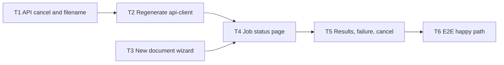

# Tasks: New Document Upload Flow

**Spec:** `specs/new-document-upload-flow/spec.md`  **Plan:** `specs/new-document-upload-flow/plan.md`
**Epic:** NDUF

## Flow

## Epic: New Document Upload Flow

### T1: Cancel extractions and return the file name and form snapshot
project: api
status: in-progress
depends_on: []
acceptance: AC32, AC33, AC34, AC36, AC37, AC38
plan: High-level approach (API first), Contracts (API → api-client, DB), File-by-file change list › api, Risks (CHECK rebuild, oasdiff, file name)
scope:
- Status `cancelled`. `Extraction.cancel(now)` works only from `pending` or `running`; from any other status it raises `ExtractionNotCancellable`.
- Repository method `cancel_if_unfinished`:
  - a conditional `UPDATE … WHERE status IN ('pending','running')` that also deletes the stored upload;
  - `finish_if_running` from a worker that finishes later changes nothing (AC36).
- Migration `v0003`:
  - adds `filename VARCHAR(255) NULL`;
  - widens `status_known` to include `cancelled` (batch mode);
  - on downgrade, `cancelled` → `failed` with `error_reason='interrupted'`;
  - tested on a database that already holds 0002 rows.
- Service and route:
  - `submit` keeps the file name: basename only, trimmed to 255 characters;
  - `POST /v1/extractions/{id}/cancel` with `operation_id`, answering 200 `ExtractionResponse`, 404 `extraction-not-found`, 409 `extraction-not-cancellable` (new `ProblemType` with a row in `docs/reference/problem-types.md`) and 422.
- `ExtractionResponse` gains:
  - `filename`, null for older rows;
  - `template_name` and `fields` (name, type, required) from the snapshot;
  - `?status=cancelled` filters the list and counts in `total` (AC37).
- Tests:
  - model;
  - repository contract;
  - service;
  - API: AC32–AC34, AC37, AC38, including a path in the file name and a name longer than 255 characters;
  - concurrency: cancel racing `finish_if_running`, with the `concurrency` marker, proved by removing the guard once;
  - purge of cancelled rows.
- `make openapi`. If `make openapi-check` fails on the new enum value, add it to `oasdiff-ignore.txt` with the reason.
files: apps/api/src/formlens/extractions/**, apps/api/src/formlens/migrations/versions/v0003_*.py, apps/api/docs/reference/problem-types.md, apps/api/openapi.json, apps/api/oasdiff-ignore.txt, apps/api/tests/extractions/**, apps/api/tests/migrations/test_migrations.py, apps/api/tests/test_health.py, apps/api/README.md, packages/api-client/src/generated/**
notes:
- Do not edit `v0001_initial.py`.
- Run `make check` before handing back. `openapi.json` is generated, never edited by hand.

### T2: Regenerate the api-client for cancel, file name and snapshot
project: "@form-lens/api-client"
status: review
depends_on: [T1]
acceptance: AC32, AC38
plan: Contracts (API → api-client), File-by-file change list › @form-lens/api-client
scope:
- Run `npm run generate -w @form-lens/api-client` from the `openapi.json` produced by T1.
- Check that the generated client:
  - exports `cancelExtraction`;
  - includes `cancelled` in `ExtractionStatus` and in the list params;
  - adds `filename`, `template_name` and `fields` to `ExtractionResponse`.
- `generate:check`, `type-check` and `test:unit` pass. Touch the hand-written `src/fetcher.ts` and `src/index.ts` only if the new operation needs it.
files: packages/api-client/src/generated/**, apps/studio/features/extractions/utils/extraction.builder.ts
notes:
- `src/generated` is never edited by hand. Fix the API and regenerate instead.

### T3: New document wizard: Choose form and Upload with submit
project: "@form-lens/studio"
status: in-progress
depends_on: []
acceptance: AC1, AC2, AC3, AC4, AC5, AC6, AC7, AC8, AC9, AC10, AC11, AC12, AC13, AC14, AC15, AC16, AC17, AC18, AC35
plan: High-level approach (Studio: wizard in the URL, server action), File-by-file change list › @form-lens/studio (wizard, config, action, card link), Reference sources (3 · Upload, 1 · Forms card), Risks (body limits)
scope:
- Config:
  - `FORMLENS_MAX_UPLOAD_MB` (default 25) in `data/env/server.ts` and `.env.example`, noting that a change needs a restart;
  - `next.config.ts` sets `serverActions.bodySizeLimit` and `proxyClientMaxBodySize` to the limit + 1 MB.
- `/documents/new`:
  - without `?template`: Choose form — cards, search, paging, the empty state and the no-match state, reusing `template-search` and `template-pager`;
  - with `?template=<id>`: Upload — the selected form with Change form, the Fields to find card, the drop zone for one file, the selected file with Remove, Start analysis and Cancel (→ `/forms`);
  - an unknown template shows the AC8 message.
- A 3-step non-interactive stepper in both steps.
- `checkFile`: PDF, PNG, JPEG or TIFF, and no larger than the limit. It runs in the drop zone, before any upload, and again in the action.
- `submitExtraction` server action:
  - calls the API with the file and template;
  - on 202, redirects to `/jobs/<id>`, taking the id from `Location`;
  - maps errors: 400/413/415/422 → a message at the drop zone; 404 template → the form is gone, with a link to Choose form; 503 with `Retry-After` → "try again in N s"; unreachable → a generic error;
  - keeps the form and the file selected after an error.
- `template-card.tsx`: "Use form" goes to `/documents/new?template=<id>`.
- Phone width: the columns stack and the page has no horizontal scroll.
- Tests:
  - unit: `checkFile`, `map-extraction-error`, `submitExtraction` with a mocked client;
  - stories with interaction tests for the steps and every error state;
  - a mimicry-js builder `extraction.builder.ts`.
files: apps/studio/data/env/server.ts, apps/studio/next.config.ts, apps/studio/.env.example, apps/studio/app/(shell)/documents/new/**, apps/studio/features/extractions/{schemas,utils,server,components}/** (wizard files: extraction.ts, accepted-file.ts, extraction.builder.ts, map-extraction-error.ts, extraction-actions.ts, new-document-stepper, choose-form-list, selected-form-item, fields-to-find-card, upload-form), apps/studio/features/templates/components/template-card.tsx, apps/studio/features/templates/components/template-card.stories.tsx, apps/studio/app/(shell)/placeholder-pages.test.tsx, apps/studio/features/templates/server/load-template*.ts, apps/studio/Dockerfile, apps/studio/.gitignore, apps/studio/biome.json, apps/studio/knip.json
notes:
- Studio rules in `.claude/rules/studio-*.md`: no `&&` rendering, `function` keyword, `Array<T>`, `import * as React`, no `useMemo`/`useCallback`.
- The API is called only from server code, through `lib/formlens-api.ts`.
- User-facing text is in English.

### T4: Job status page with live polling
project: "@form-lens/studio"
status: in-progress
depends_on: [T2, T3]
acceptance: AC19, AC20, AC21, AC22, AC23, AC27, AC28, AC29, AC35, AC39
plan: High-level approach (Studio: status page, polling via route handler), Contracts (Studio internal GET), File-by-file change list › @form-lens/studio (status page, hook, route handler, breadcrumbs), Reference sources (4 · Processing)
scope:
- `ExtractionView` Zod schema. `load-extraction` (`server-only`, `React.cache`) returns view, not found or unreachable.
- `GET /api/extractions/[id]`: answers 200 / 404 / 502, `force-dynamic`, `Cache-Control: no-store`.
- `use-extraction-status`:
  - checks every 3 s;
  - stops on completed, failed or cancelled;
  - pauses while the tab is hidden, and checks once at once when it is visible again;
  - sets an `unreachable` flag that clears on the next success.
- `/jobs/[id]` loads the first render on the server, then hands over to the hook. Unknown or expired → AC28, with a link to New document.
- `extraction-status-view`:
  - the header and a badge;
  - `filename · template_name` as plain text, form only when there is no file name;
  - the submit time;
  - the status stepper (Uploaded → Waiting in queue → Reading document → Done/Failed/Cancelled);
  - the outage notice;
  - the footer "Polling job status every 3 seconds" with the id.
- Results card: a `Skeleton` per snapshot field while the extraction is unfinished.
- Breadcrumbs: `/jobs/<id>` → "Jobs / <id>".
- Phone width: the cards stack.
- Tests:
  - unit: `status-steps`, `load-extraction`, route handler, and the hook with fake timers and `visibilitychange`;
  - stories: pending, running, unreachable, no file name, and a file name with HTML.
files: apps/studio/app/(shell)/jobs/[id]/**, apps/studio/app/api/extractions/[id]/**, apps/studio/features/extractions/schemas/extraction.ts, apps/studio/features/extractions/server/load-extraction*.ts, apps/studio/features/extractions/hooks/**, apps/studio/features/extractions/utils/status-steps*.ts, apps/studio/features/extractions/components/{extraction-status-view,status-stepper,results-card}*, apps/studio/components/layout/app-breadcrumbs*.tsx, apps/studio/.storybook/**, apps/studio/package.json, package-lock.json, apps/studio/public/mockServiceWorker.js
notes:
- The status type must handle `cancelled` from the regenerated client (T2).

### T5: Results, failure and Cancel job on the status page
project: "@form-lens/studio"
status: review
depends_on: [T4]
acceptance: AC24, AC25, AC26, AC30, AC31
plan: File-by-file change list › @form-lens/studio (results-card, extraction-failed, cancel-job-dialog, cancelExtraction), Edge cases (cancel races completion)
scope:
- `result-rows`: one row per snapshot field in form order, with its value, "Not found", or "Missing required". The results card shows a summary of missing required fields and a "New document" action.
- `extraction-failed`: shows the API's error message and "Try again" → `/documents/new?template=<id>`.
- `cancelExtraction` server action and `cancel-job-dialog`:
  - the dialog asks for confirmation; confirming shows the extraction as cancelled and stops the checks; dismissing changes nothing;
  - a 409 refetches and shows the final result (cancel races completion);
  - "Cancel job" shows only while the extraction is unfinished.
- Tests:
  - unit: `result-rows`, `cancelExtraction`;
  - stories: completed (with "Not found" and "Missing required"), failed, cancelled, the confirm and dismiss paths, and the 409 race.
files: apps/studio/features/extractions/utils/result-rows*.ts, apps/studio/features/extractions/server/extraction-actions*.ts, apps/studio/features/extractions/components/{results-card,extraction-failed,cancel-job-dialog,extraction-status-view}*, apps/studio/features/extractions/schemas/extraction.ts, apps/studio/features/extractions/server/load-extraction.test.ts, apps/studio/app/(shell)/jobs/[id]/page.tsx

### T6: End-to-end happy path of the new document flow
project: "@form-lens/studio"
status: review
depends_on: [T5]
acceptance: AC6, AC14, AC21, AC24
plan: File-by-file change list › @form-lens/studio (`tests/e2e/new-document.spec.ts`)
scope:
- Playwright, following the existing E2E setup:
  - Forms → Use form → upload a PDF → land on `/jobs/<id>`;
  - the status moves pending → running → completed without a reload;
  - the values appear in form order.
- The API is stubbed, or a fake extractor is used, following the existing E2E setup. The test needs no real models.
files: apps/studio/tests/e2e/new-document.e2e.ts

Order: (T1 → T2) ∥ T3 → T4 → T5 → T6
